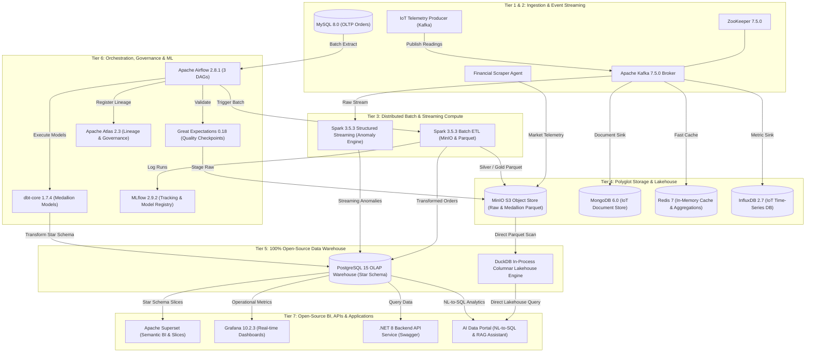
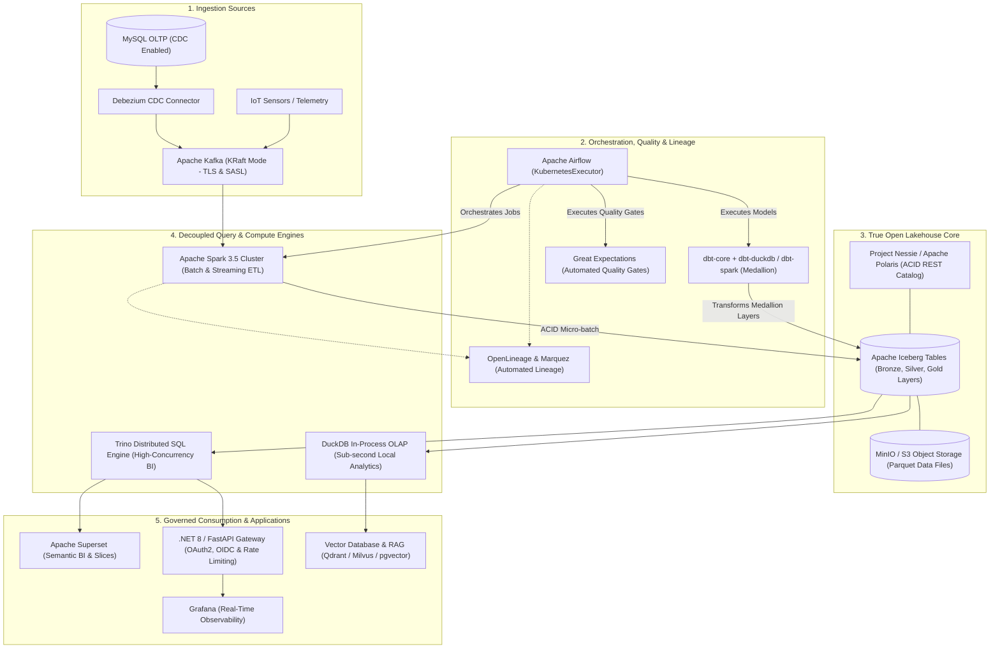

# Open Lakehouse Platform (`open-lakehouse-platform`)

[](https://github.com/Amit1092tiwari/open-lakehouse-platform)

[](https://www.python.org/)
[](https://dotnet.microsoft.com/)
[](https://learn.microsoft.com/en-us/dotnet/csharp/)
[](https://spark.apache.org/)
[](https://airflow.apache.org/)
[](https://kafka.apache.org/)
[](https://duckdb.org/)
[](https://www.postgresql.org/)
[](https://superset.apache.org/)
[](https://grafana.com/)
[](https://min.io/)
[](https://www.influxdata.com/)
[](https://redis.io/)
[](https://www.mongodb.com/)
[](https://mlflow.org/)
[](https://www.getdbt.com/)
[](https://www.docker.com/)
[](https://opensource.org/licenses/MIT)

A production-ready, fully containerized, vendor-independent enterprise data platform. All proprietary SaaS cloud dependencies (Snowflake, Tableau, Looker, Power BI) have been decoupled and replaced with premier **100% open-source technologies** (**PostgreSQL 15 OLAP Star Schema**, **DuckDB Columnar Lakehouse Engine**, **Apache Superset**, **Grafana**, and **MinIO**).

Every module features structured, observable logging reporting:
`[INPUT EXPECTED]` ➔ `[INPUT RECEIVED]` ➔ `[PROCESSING]` ➔ `[OUTPUT EXPECTED]` ➔ `[OUTPUT RECEIVED]`

---

## Table of Contents

- [Architecture](#architecture)
- [Target State Architecture (The "True Open Lakehouse")](#target-state-architecture-the-true-open-lakehouse)
- [Open-Source Technology Replacement Summary](#open-source-technology-replacement-summary)
- [Module Specifications: Inputs, Processing & Outputs](#module-specifications-inputs-processing--outputs)
  - [1. Batch Ingestion DAG (Airflow)](#1-batch-ingestion-dag-airflow)
  - [2. Production Spark Batch ETL Job](#2-production-spark-batch-etl-job)
  - [3. IoT Sensor Telemetry Producer (Kafka)](#3-iot-sensor-telemetry-producer-kafka)
  - [4. Spark Structured Streaming Anomaly Detector](#4-spark-structured-streaming-anomaly-detector)
  - [5. MinIO & InfluxDB Storage Sink (Replaced AWS S3)](#5-minio--influxdb-storage-sink-replaced-aws-s3)
  - [6. MongoDB Document Store Streaming Sink](#6-mongodb-document-store-streaming-sink)
  - [7. Redis Real-Time Caching & Running Stats Sink](#7-redis-real-time-caching--running-stats-sink)
  - [8. Open-Source Data Warehouse Connector (Replaced Snowflake)](#8-open-source-data-warehouse-connector-replaced-snowflake)
  - [9. Warehouse Star-Schema Transformation DAG](#9-warehouse-star-schema-transformation-dag)
  - [10. dbt Medallion Architecture (Bronze, Silver, Gold)](#10-dbt-medallion-architecture-bronze-silver-gold)
  - [11. Open-Source BI Dashboards (Apache Superset & Grafana)](#11-open-source-bi-dashboards-apache-superset--grafana)
  - [12. AI Data Portal & RAG Vector Pipeline](#12-ai-data-portal--rag-vector-pipeline)
  - [13. Financial Market Scraper & Analytics Pipeline](#13-financial-market-scraper--analytics-pipeline)
  - [14. .NET 8 Backend REST API](#14-net-8-backend-rest-api)
- [Project Directory Structure](#project-directory-structure)
- [Service URLs & Ports](#service-urls--ports)
- [Quick Start Guide](#quick-start-guide)
- [Testing & Quality Verification](#testing--quality-verification)
- [License](#license)

---

## Architecture



---

## Target State Architecture (The "True Open Lakehouse")

To evolve from a polyglot relational/file-staging pipeline into an enterprise-grade **True Open Lakehouse**, the target state architecture unifies storage under **Apache Iceberg**, eliminates proprietary SQL lock-in, introduces real-time CDC, and decouples storage from multi-engine compute.



### Core Architectural Pillars of the Target State

1. **Open Table Format & ACID Catalog (Apache Iceberg + Polaris/Nessie)**:
   - Replaces static Parquet and CSV overwrites with **Apache Iceberg**, providing ACID transactions, time travel, schema evolution, and hidden partitioning.
   - A central REST catalog (**Apache Polaris** or **Project Nessie**) provides Git-like branch-and-merge isolation for data pipelines and multi-engine consistency across Spark, Trino, and DuckDB.

2. **Real-time Change Data Capture (Debezium + Kafka KRaft)**:
   - Eliminates high-overhead polling queries (`SELECT * FROM orders`) on source OLTP systems by streaming MySQL binlog changes directly to Kafka via **Debezium**.
   - Upgrades Apache Kafka to **KRaft mode** (removing ZooKeeper dependency) with end-to-end TLS encryption and SASL/SCRAM authentication.

3. **Decoupled Multi-Engine Query Federation**:
   - **Apache Spark 3.5**: Handles heavy distributed batch transformations, streaming anomaly detection, and ML feature preparation.
   - **Trino**: Provides high-concurrency, low-latency SQL query execution directly over Iceberg tables for BI tools (Superset) without data duplication.
   - **DuckDB**: Serves embedded, sub-second OLAP queries and local analytics for the AI Data Portal and Python microservices.

4. **Orchestrated Medallion Governance (dbt + Airflow + Great Expectations)**:
   - Unifies dbt models under a standardized SQL dialect (`dbt-duckdb` or `dbt-spark`) executed natively inside containerized Airflow tasks.
   - Great Expectations checkpoints run as automated quality gates at layer boundaries (Bronze -> Silver -> Gold) with automated quarantine of bad records.

5. **Zero-Trust Security & Automated Lineage**:
   - **API Security**: Secures the REST API Gateway with OAuth2 / OIDC JWT validation, role-based access control (RBAC), and per-client rate limiting.
   - **Automated Metadata & Lineage**: Integrates **OpenLineage** and **Marquez** into Spark and Airflow runs to capture end-to-end operational lineage and dataset dependencies automatically.

### Architecture Transition Matrix

| Capability / Tier | Current State Architecture | Target State Architecture | Primary Business & Technical Benefit |
| :--- | :--- | :--- | :--- |
| **Storage Table Format** | Raw Parquet / CSV files with overwrite | **Apache Iceberg (ACID)** | Snapshot isolation, zero read-write contention, safe concurrent writes. |
| **Catalog Management** | Directory paths in MinIO buckets | **Iceberg REST Catalog (Polaris / Nessie)** | Multi-engine consistency (Spark, DuckDB, Trino sharing one catalog). |
| **OLTP Ingestion** | Scheduled batch polling (`SELECT *`) | **Debezium CDC via Kafka** | Real-time synchronization, zero query load on operational databases. |
| **Message Broker** | Kafka with ZooKeeper (PLAINTEXT) | **Kafka KRaft Mode (TLS + SASL)** | Simplified topology, lower latency, enterprise security posture. |
| **Data Transformation** | Procedural SQL + separate dbt models | **Orchestrated dbt on Iceberg** | Version-controlled, testable, DRY transformation logic across tiers. |
| **Interactive BI Querying** | Relational PostgreSQL Star Schema | **Trino Distributed Engine** | Scalable sub-second queries directly on the lake; eliminates DB staging. |
| **API & Gateway Security** | Public unauthenticated REST endpoints | **OAuth2 / OIDC + API Gateway** | Hardened endpoints, audit logging, protected administrative triggers. |
| **Data Lineage** | Manual REST stub calls | **OpenLineage + Marquez** | Automated runtime lineage graphs across Spark jobs and Airflow DAGs. |

---

## Open-Source Technology Replacement Summary

| Proprietary Component | Open-Source Replacement | Canonical Module | License | Key Benefit |
| :--- | :--- | :--- | :--- | :--- |
| **Snowflake** (Cloud SaaS) | **PostgreSQL 15 Star Schema** + **DuckDB Columnar Engine** | `warehouse/warehouse_connector.py` | PostgreSQL License & MIT | 100% self-hosted, zero subscription cost, fast local and distributed query execution. |
| **Tableau / Looker / Power BI** | **Apache Superset** + **Grafana 10.2** | `bi_dashboards/bi_dashboard.py` | Apache 2.0 & AGPLv3 | Declarative dataset exports, open semantic layer, containerized dashboards on port 3000. |
| **AWS S3** | **MinIO S3-Compatible Object Storage** | `storage/minio_influxdb.py` | AGPLv3 | High-performance, S3 API compatibility, self-hosted on port 9000/9001. |

---

## Module Specifications: Inputs, Processing & Outputs

### 1. Batch Ingestion DAG (Airflow)
- **Module File:** `airflow/dags/batch_ingestion_dag.py`
- **Schedule:** `@daily` (Midnight UTC)
- **Expected Input:**
  - *Source:* MySQL OLTP Database (`orders` table).
  - *Schema:* `order_id (INT)`, `customer_id (INT)`, `amount (DECIMAL(10,2))`, `created_at (TIMESTAMP)`.
- **Received Input:**
  - Extracted as a structured pandas DataFrame via `MySqlHook(mysql_conn_id="mysql_default")`.
- **List of Processing Going Through:**
  1. Primary key non-null validation (`order_id IS NOT NULL`).
  2. Domain verification (`customer_id > 0`).
  3. Positive monetary value assertion (`amount > 0.00`).
  4. Great Expectations checkpoint execution (`raw_data_validation.py`).
  5. Raw CSV upload to MinIO S3 bucket `raw-data/orders/orders.csv`.
  6. Trigger PySpark batch transformation engine (`spark_batch_job.py`).
  7. High-throughput bulk load into PostgreSQL staging table `orders_transformed`.
- **Expected Output:**
  - *Lake Destination:* `s3a://raw-data/orders/orders.csv`.
  - *Database Destination:* PostgreSQL `orders_transformed` staging table.
- **Received Output:**
  - Staged raw file confirmation, Great Expectations validation suite certificate, and PostgreSQL row count confirmation.
- **Module Log Signature:**
  ```text
  [INPUT EXPECTED] Source: MySQL database table 'orders' (order_id, customer_id, amount, created_at)
  [INPUT RECEIVED] Extracted 1,000 order records from MySQL source.
  [PROCESSING] Executing data quality validation suite (non-null order_id, positive amount)...
  [OUTPUT RECEIVED] Great Expectations data quality validation passed.
  [OUTPUT EXPECTED] Destination: MinIO bucket 'raw-data', key 'orders/orders.csv'
  [OUTPUT RECEIVED] Raw orders dataset uploaded to MinIO: s3://raw-data/orders/orders.csv
  [PROCESSING] Bulk inserting 1,000 records into PostgreSQL table 'orders_transformed'...
  [OUTPUT RECEIVED] Bulk insert completed: 1,000 rows loaded into PostgreSQL.
  ```

---

### 2. Production Spark Batch ETL Job
- **Module File:** `spark/spark_batch_job.py`
- **Execution Mode:** Spark Master/Worker distributed compute.
- **Expected Input:**
  - *Source:* MinIO S3 Object Store (`s3a://raw-data/orders/orders.csv`).
  - *Format:* CSV with header.
  - *Schema:* `order_id (int)`, `customer_id (int)`, `amount (double)`.
- **Received Input:**
  - PySpark distributed DataFrame read with S3A Hadoop filesystem.
- **List of Processing Going Through:**
  1. Distributed schema casting (no driver memory bottleneck).
  2. Cluster-native assertion checks for nulls, non-positive amounts, and invalid customer IDs.
  3. Deduplication on `order_id`.
  4. Null value imputation (`amount = 0.0`).
  5. Deterministic timestamp enrichment (`processed_timestamp = current_timestamp()`).
  6. Customer-level Gold aggregation (`total_spent`, `order_count`).
  7. Columnar Parquet conversion with Snappy compression.
- **Expected Output:**
  - *Medallion Silver Lake:* `s3a://processed-data/orders_transformed.parquet`.
  - *CSV Compatibility Export:* `s3a://processed-data/orders_transformed.csv`.
  - *Local Staging Export:* `/tmp/transformed_orders.csv`.
- **Received Output:**
  - Partitioned, Snappy-compressed Parquet files and local CSV export.
- **Module Log Signature:**
  ```text
  [INPUT EXPECTED] Location: s3a://raw-data/orders/orders.csv | Format: CSV (header=true)
  [INPUT RECEIVED] Ingested raw batch containing 1,000 records from MinIO.
  [PROCESSING] Executing distributed data quality assertions...
  [PROCESSING] Step 1/3: Deduplication by order_id and null amount filling.
  [PROCESSING] Step 2/3: Timestamp enrichment with current UTC timestamp.
  [PROCESSING] Step 3/3: Calculating gold aggregate metrics grouped by customer_id.
  [OUTPUT EXPECTED] Destination: s3a://processed-data/orders_transformed.parquet (Snappy Parquet)
  [OUTPUT RECEIVED] Persisted 995 records to MinIO Parquet path: s3a://processed-data/orders_transformed.parquet
  [OUTPUT RECEIVED] Spark Batch ETL completed successfully.
  ```

---

### 3. IoT Sensor Telemetry Producer (Kafka)
- **Module File:** `kafka/producer.py`
- **Expected Input:**
  - *Configuration:* Message frequency (1.0s), batch size (10 events), broker (`kafka:29092`), topic (`sensor_readings`).
- **Received Input:**
  - Continuous runtime generator generating UUIDv4 event keys, Unix epoch timestamps, device IDs (1000–9999), and reading values (20.0–80.0°C / PSI).
- **List of Processing Going Through:**
  1. Dynamic broker availability check and retry backoff.
  2. Idempotent topic existence verification and auto-creation (3 partitions, replication factor 1).
  3. Micro-batch array buffering.
  4. UTF-8 JSON serialization.
  5. Broker dispatch with `acks='all'`.
- **Expected Output:**
  - Stream of JSON events delivered to Kafka broker `kafka:29092` under topic `sensor_readings`.
- **Received Output:**
  - Partition offsets and cumulative dispatch confirmations.
- **Module Log Signature:**
  ```text
  [INPUT EXPECTED] Simulation parameters: Interval=1.0s, BatchSize=10, Broker=kafka:29092, Topic=sensor_readings
  [INPUT RECEIVED] Generated batch of 10 sensor readings (Sample device_id: 4210, value: 74.82)
  [PROCESSING] Serializing batch of 10 records to JSON bytes with gzip/batch compression...
  [OUTPUT EXPECTED] Destination: Kafka topic 'sensor_readings' with acks='all'
  [OUTPUT RECEIVED] Flushed batch of 10 messages to Kafka (Cumulative sent: 1,520).
  ```

---

### 4. Spark Structured Streaming Anomaly Detector
- **Module File:** `spark/spark_streaming_job.py`
- **Expected Input:**
  - *Source:* Kafka topic `sensor_readings`.
  - *Schema:* JSON payload `{event_id: string, timestamp: long, device_id: long, reading_value: double}`.
- **Received Input:**
  - Micro-batches streamed with backpressure limit (`maxOffsetsPerTrigger=10000`).
- **List of Processing Going Through:**
  1. JSON deserialization against `SENSOR_SCHEMA`.
  2. Event-time conversion: `reading_timestamp = to_timestamp(timestamp / 1000)`.
  3. Ingestion timestamp enrichment: `processed_at = current_timestamp()`.
  4. Non-null data validation filter.
  5. Anomaly threshold evaluation: `reading_value > 70.0`.
  6. Parallel multi-sink routing.
- **Expected Output:**
  - *Sink 1:* MinIO raw telemetry Parquet stream (`s3a://raw-data/streaming_raw/`).
  - *Sink 2:* MinIO anomalies Parquet stream (`s3a://processed-data/streaming_anomalies/`).
  - *Sink 3:* PostgreSQL `anomalies_stream` table via micro-batch JDBC append.
- **Received Output:**
  - Parquet partition commits and PostgreSQL row commits per 10-second micro-batch trigger.
- **Module Log Signature:**
  ```text
  [INPUT EXPECTED] Source: Kafka topic 'sensor_readings' on broker 'kafka:29092'
  [PROCESSING] Deserializing JSON Kafka payload against SENSOR_SCHEMA...
  [PROCESSING] Filtering anomalies with reading_value > 70.0...
  [INPUT RECEIVED] Micro-batch 4: 12 anomaly records received for persistence.
  [OUTPUT EXPECTED] Destination: PostgreSQL table 'anomalies_stream' at postgres:5432
  [OUTPUT RECEIVED] Micro-batch 4 successfully committed: 12 anomalies persisted to PostgreSQL.
  ```

---

### 5. MinIO & InfluxDB Storage Sink (Replaced AWS S3)
- **Module File:** `storage/minio_influxdb.py` *(replaces `storage/aws_s3_influxdb.py`)*
- **Expected Input:**
  - *Streaming Input:* Kafka events from `sensor_readings`.
  - *Extraction Input:* InfluxDB time-series records for past 24 hours.
- **Received Input:**
  - Dictionary objects with `device_id`, `reading_value`, and `timestamp`.
- **List of Processing Going Through:**
  1. Payload validation and type verification.
  2. InfluxDB `Point` object assembly with measurement `sensor_readings`, tag `device_id`, and second-precision timestamp.
  3. Continuous write to InfluxDB bucket `iot_data`.
  4. Periodic extraction via Flux query (`from(bucket: "iot_data") |> range(start: -24h)`).
  5. Tabular pivoting and CSV serialization with UTC ISO timestamps.
  6. S3 API upload to MinIO S3 object store.
- **Expected Output:**
  - *Time-Series:* InfluxDB bucket `iot_data`.
  - *Object Storage:* MinIO `s3://raw-data/iot_data/iot_data_<timestamp>.csv`.
- **Received Output:**
  - Time-series point insertions and MinIO object creation confirmations.
- **Module Log Signature:**
  ```text
  [INPUT EXPECTED] Source: Kafka topic 'sensor_readings' on broker 'kafka:29092'
  [OUTPUT EXPECTED] Destination: InfluxDB at http://influxdb:8086 | Org: 'pipeline-org' | Bucket: 'iot_data'
  [PROCESSING] Commencing streaming consumption from Kafka into InfluxDB...
  [OUTPUT RECEIVED] InfluxDB Sink: Ingested 500 sensor points successfully.
  [INPUT EXPECTED] Source: InfluxDB bucket 'iot_data' (range: last 24h)
  [INPUT RECEIVED] Extracted 1,200 records from InfluxDB.
  [OUTPUT RECEIVED] InfluxDB snapshot uploaded successfully to MinIO at s3://raw-data/iot_data/iot_data_20261102.csv
  ```

---

### 6. MongoDB Document Store Streaming Sink
- **Module File:** `storage/mongodb_streaming.py`
- **Expected Input:**
  - Kafka message payload containing raw sensor events.
- **Received Input:**
  - Deserialized JSON dictionary.
- **List of Processing Going Through:**
  1. Data structure validation (`validate_and_transform_sensor_reading`).
  2. Device ID and float reading value verification.
  3. UTC ingestion timestamp attachment (`datetime.now(timezone.utc)`).
  4. Document construction.
- **Expected Output:**
  - MongoDB collection `sensor_readings` inside database `iot_data`.
- **Received Output:**
  - BSON Document insert with assigned `_id`.
- **Module Log Signature:**
  ```text
  [INPUT EXPECTED] Source: Kafka topic 'sensor_readings' | Schema: {event_id, device_id, reading_value, timestamp}
  [OUTPUT EXPECTED] Destination: MongoDB database 'iot_data', collection 'sensor_readings'
  [OUTPUT RECEIVED] Connected to MongoDB at mongodb://mongodb:27017/
  [OUTPUT RECEIVED] Stored 100 documents in MongoDB 'iot_data.sensor_readings'.
  ```

---

### 7. Redis Real-Time Caching & Running Stats Sink
- **Module File:** `storage/redis_integration.py`
- **Expected Input:**
  - Sensor reading dictionary from Kafka.
- **Received Input:**
  - Individual reading: `device_id`, `reading_value`.
- **List of Processing Going Through:**
  1. Cache latest reading with 1-hour TTL (`device:{device_id}:latest`).
  2. Atomic count increment: `HINCRBY device:{device_id}:stats count 1`.
  3. Atomic sum increment: `HINCRBYFLOAT device:{device_id}:stats total <val>`.
  4. Running average computation: `avg_reading = total / count`.
  5. Push enriched metric payload to Redis LPUSH queue `processed_queue`.
  6. Forward message to Kafka topic `processed_readings`.
- **Expected Output:**
  - *Redis Cache:* Latest reading string and stats hash.
  - *Kafka Topic:* `processed_readings`.
- **Received Output:**
  - Sub-millisecond in-memory cache updates and message publication.
- **Module Log Signature:**
  ```text
  [INPUT EXPECTED] Source: Kafka topic 'sensor_readings' | Schema: {device_id, reading_value}
  [OUTPUT EXPECTED] Redis Cache: keys 'device:{id}:latest', 'device:{id}:stats' & Forward Topic: 'processed_readings'
  [OUTPUT RECEIVED] Connected to Redis at redis:6379
  [OUTPUT RECEIVED] Processed 100 messages: Cached stats in Redis and forwarded to 'processed_readings'.
  ```

---

### 8. Open-Source Data Warehouse Connector (Replaced Snowflake)
- **Module File:** `warehouse/warehouse_connector.py` *(replaces `snowflake/snowflake_connector.py`)*
- **DDL File:** `warehouse/init_warehouse.sql`
- **Expected Input:**
  - SQL DDL/DML statements or pandas DataFrames.
- **Received Input:**
  - DataFrames or parameterized SQL queries targeting star-schema tables (`dim_customers`, `dim_date`, `fact_orders`, `agg_daily_orders`).
- **List of Processing Going Through:**
  1. Engine detection: PostgreSQL Star Schema (TCP port 5432) or DuckDB in-process columnar engine.
  2. Transactional session management with auto-commit and rollback on error.
  3. Bulk table loading (DuckDB view registration or PostgreSQL fast batch insertion).
  4. Direct Parquet/CSV lakehouse staging copy (`stage_and_copy()`).
  5. Snowflake bridge: `snowflake/snowflake_connector.py` intercepts calls and automatically routes them to `warehouse_connector.py` if commercial Snowflake credentials are not supplied.
- **Expected Output:**
  - Relational star-schema tables in PostgreSQL `processed_db` or DuckDB database `warehouse.duckdb`.
- **Received Output:**
  - Committed row counts, query result DataFrames, and connection health status.
- **Module Log Signature:**
  ```text
  [OUTPUT RECEIVED] Connected to PostgreSQL open-source warehouse: pipeline_user@postgres:5432/processed_db
  [INPUT RECEIVED] Received DataFrame with 1,000 rows and columns: ['order_id', 'customer_id', 'amount']
  [OUTPUT EXPECTED] Destination table: 'fact_orders' (mode: append)
  [PROCESSING] Loading DataFrame via PostgreSQL SQLAlchemy engine...
  [OUTPUT RECEIVED] Loaded 1,000 rows into PostgreSQL table 'fact_orders'.
  ```

---

### 9. Warehouse Star-Schema Transformation DAG
- **Module File:** `airflow/dags/warehouse_transform_dag.py`
- **Schedule:** `@hourly`
- **Expected Input:**
  - Staging tables: `orders_transformed` and `anomalies_stream`.
- **Received Input:**
  - Staged records from PostgreSQL / Spark batch output.
- **List of Processing Going Through:**
  1. Extract and stage orders into dimension tables (`dim_customers` upsert with SCD Type 1/2 tracking).
  2. Extract and stage sensor anomaly events into `dim_devices`.
  3. Load transactional fact table `fact_orders` with date key resolution.
  4. Load sensor anomaly fact table `fact_sensor_readings`.
  5. Refresh materialized aggregation tables (`agg_daily_orders` total revenue, order count, unique customers).
  6. Audit pipeline execution in `fact_pipeline_runs`.
- **Expected Output:**
  - Updated warehouse dimensional models and daily aggregation tables.
- **Received Output:**
  - Aggregation refreshes and audit trail execution logs.
- **Module Log Signature:**
  ```text
  [INPUT EXPECTED] Source: PostgreSQL table 'orders_transformed'
  [INPUT RECEIVED] Extracted 1,000 orders from PostgreSQL.
  [PROCESSING] Staging orders in PostgreSQL open-source warehouse (dim_customers upsert)...
  [OUTPUT RECEIVED] Staged orders into PostgreSQL open-source warehouse.
  [OUTPUT RECEIVED] AGG_DAILY_ORDERS refreshed in open-source warehouse.
  [OUTPUT RECEIVED] Logged pipeline execution run to fact_pipeline_runs.
  ```

---

### 10. dbt Medallion Architecture (Bronze, Silver, Gold)
- **Directory:** `dbt_medallion/`
- **Profile:** PostgreSQL / DuckDB (`dbt_project.yml`)
- **Expected Input:**
  - Bronze raw seed/source tables (`raw_orders`, `raw_customers`).
- **Received Input:**
  - Staged raw relational rows from source OLTP systems.
- **List of Processing Going Through:**
  1. *Bronze Staging (`models/staging/ecommerce/`):* Standardize column casing, data types, and timestamps (`stg_ecommerce__orders.sql`, `stg_ecommerce__customers.sql`).
  2. *Silver Intermediate (`models/intermediate/`):* Deduplicate orders by `order_id`, join with customer dimensions, generate MD5 surrogate keys (`order_hk`), calculate `net_realized_revenue`, and assign `order_value_tier` (`int_orders_enriched.sql`).
  3. *Gold Dimensional Marts (`models/marts/`):* Materialize customer loyalty dimension (`dim_customers.sql`) and incremental daily customer orders fact mart with clustering (`fct_daily_customer_orders.sql`).
- **Expected Output:**
  - Production-ready dimensional marts, surrogate-keyed facts, and daily KPI views.
- **Received Output:**
  - Tested, validated relational models.

---

### 11. Open-Source BI Dashboards (Apache Superset & Grafana)
- **Module File:** `bi_dashboards/bi_dashboard.py`
- **Expected Input:**
  - Analytical queries executed against the open-source warehouse (`dim_date`, `agg_daily_orders`, `dim_customers`, `fact_orders`).
- **Received Input:**
  - Aggregated metric query results.
- **List of Processing Going Through:**
  1. Warehouse query execution via PostgreSQL/DuckDB engines.
  2. CSV dataset serialization to `/tmp/bi_exports/`.
  3. Apache Superset metadata generation: declarative dataset schemas, metric formulas (`SUM(total_revenue)`, `COUNT(order_key)`), and chart slices saved to `apache_superset_datasources.json`.
  4. Grafana dashboard JSON assembly: KPI stat cards, time-series revenue trends, customer segment breakdown pie charts, and anomaly gauges.
  5. Optional automated REST API publication to Grafana server (`http://grafana:3000/api/dashboards/db`).
- **Expected Output:**
  - `apache_superset_datasources.json` for Superset and `grafana_bi_dashboard.json` for Grafana.
- **Received Output:**
  - Declarative dashboard definition files and active Grafana dashboards.
- **Module Log Signature:**
  ```text
  [INPUT EXPECTED] Source warehouse: PostgreSQL Open-Source Warehouse
  [PROCESSING] Executing warehouse analytical query for 'daily_orders_summary'...
  [INPUT RECEIVED] Query 'daily_orders_summary' returned 365 records.
  [OUTPUT RECEIVED] Exported daily_orders_summary: 365 rows -> /tmp/bi_exports/daily_orders_summary.csv
  [PROCESSING] Generating declarative dataset definitions and chart slice specs for Apache Superset...
  [OUTPUT RECEIVED] Exported Apache Superset open-source BI metadata: /tmp/bi_exports/apache_superset_datasources.json
  [PROCESSING] Constructing Grafana dashboard model with revenue, order, anomaly, and SLA panels...
  [OUTPUT RECEIVED] Exported Grafana open-source dashboard model: /tmp/bi_exports/grafana_bi_dashboard.json
  ```

---

### 12. AI Data Portal & RAG Vector Pipeline
- **Module Files:** `apps/ai_data_portal/app.py` & `ai_vector_pipeline/vector_ingestion_engine.py`
- **Expected Input:**
  - Natural language user prompts (e.g., *"Show top revenue days"*, *"Which device had anomalies?"*).
  - Unstructured enterprise technical documentation and architecture markdown files.
- **Received Input:**
  - User strings and document collections.
- **List of Processing Going Through:**
  1. *Document Chunker (`DocumentChunker`):* Recursive boundary-aware paragraph text chunking with sliding token overlaps.
  2. *Embedding Generator (`EmbeddingGenerator`):* Batch normalized dense vector embeddings with exponential backoff retry policies.
  3. *Hybrid Vector Index (`HybridVectorIndex`):* Dense cosine similarity vector search fused with sparse BM25 lexical keyword retrieval via Reciprocal Rank Fusion (RRF).
  4. *NL-to-SQL Service:* Rule-based and semantic natural language parsing generating valid PostgreSQL warehouse queries.
- **Expected Output:**
  - Synthesized RAG answers, ranked semantic context chunks, and live executive KPIs.
- **Received Output:**
  - Live query results and interactive assistant delivered through the AI Data Portal UI on port `8000`.

---

### 13. Financial Market Scraper & Analytics Pipeline
- **Module Files:** `scripts/indian_stock_market_scraper.py`
- **Expected Input:**
  - NSE Nifty 50 and Indian equity market ticker symbols (e.g., `^NSEI`, `RELIANCE.NS`, `TCS.NS`).
- **Received Input:**
  - Real-time market JSON quotes and historical OHLCV bars.
- **List of Processing Going Through:**
  1. Automated crumb authentication and session handshake.
  2. Batch quote querying with exponential retry backoff.
  3. Technical indicator calculation (SMA 20/50, RSI 14, Bollinger Bands).
  4. Schema assertion and data contract validation.
  5. Multi-format export (Markdown, CSV, JSON) and real-time streaming agent loop.
- **Expected Output:**
  - Market datasets in `data/financial/`, continuous CSV telemetry, and visual financial reports.
- **Received Output:**
  - Persisted market datasets and visual financial reports.

---

### 14. .NET 8 Backend REST API
- **Directory:** `sample_dotnet_backend/src/DataPipelineApi/`
- **Port:** `5000` (Swagger UI at `/swagger`)
- **Expected Input:**
  - HTTP REST requests from frontend dashboards, CLI tools, or external services.
- **Received Input:**
  - JSON request bodies (`BatchRequest`, `StreamingRequest`) or query parameters.
- **List of Processing Going Through:**
  1. API Gateway security enforcement via `ApiKeyAuthMiddleware` (`X-API-Key` & Bearer auth) and Swagger authorization integration.
  2. Request ID correlation and Serilog structured logging.
  3. Polly resilience policies (3x exponential backoff).
  4. Dapper micro-ORM querying against PostgreSQL open-source warehouse.
  5. Airflow REST API integration triggering ETL DAGs.
  6. Health check aggregator inspecting database, broker, object store, and cache connectivity.
- **Expected Output:**
  - JSON responses with standard status codes (200 OK, 503 Service Unavailable).
- **Received Output:**
  - Aggregated KPIs, pipeline run records, and warehouse operational status.

---

## Project Directory Structure

```
├── airflow/                              # Apache Airflow Orchestration
│   ├── Dockerfile
│   ├── requirements.txt
│   └── dags/
│       ├── batch_ingestion_dag.py        # Daily batch ETL (MySQL -> MinIO -> Spark -> Postgres)
│       ├── streaming_monitoring_dag.py   # Kafka broker & consumer lag monitoring
│       └── warehouse_transform_dag.py    # Hourly open-source warehouse ETL
├── spark/                                # Apache Spark 3.5.3 Compute Engine
│   ├── Dockerfile
│   ├── spark_batch_job.py                # Batch ETL (MinIO -> Snappy Parquet -> Postgres)
│   └── spark_streaming_job.py            # Real-time Kafka consumer + anomaly detection
├── kafka/                                # Distributed Event Streaming
│   ├── Dockerfile
│   └── producer.py                       # IoT sensor telemetry generator
├── storage/                              # Polyglot Storage Sinks (100% Open Source)
│   ├── minio_influxdb.py                 # [NEW] MinIO S3 store & InfluxDB time-series sink
│   ├── aws_s3_influxdb.py                # Backward-compatibility alias to minio_influxdb
│   ├── mongodb_streaming.py              # MongoDB document collection streaming sink
│   ├── redis_integration.py              # Redis in-memory cache & running stats
│   └── hadoop_batch_processing.py        # Distributed batch processing utilities
├── warehouse/                            # [NEW] 100% Open-Source Data Warehouse
│   ├── __init__.py                       # Package exports
│   ├── warehouse_connector.py            # PostgreSQL Star Schema & DuckDB Columnar connector
│   └── init_warehouse.sql                # Open-source star-schema DDL & automated date dimension
├── snowflake/                            # Optional Commercial Extension (Decoupled)
│   ├── snowflake_connector.py            # Bridges transparently to warehouse_connector
│   └── init_warehouse.sql                # Reference Snowflake DDL
├── dbt_medallion/                        # dbt-core 1.7.4 Medallion Transformation
│   ├── dbt_project.yml
│   └── models/
│       ├── staging/                      # Bronze cleaned staging models
│       ├── intermediate/                 # Silver enriched business entities
│       └── marts/                        # Gold analytics marts and dimensional stars
├── bi_dashboards/                        # Business Intelligence & Visualization
│   └── bi_dashboard.py                   # Exports to Apache Superset & Grafana
├── apps/                                 # Applications & Interactive Interfaces
│   └── ai_data_portal/                   # AI Data Portal (NL-to-SQL & RAG Assistant)
│       ├── app.py                        # Web application service (:8000)
│       └── static/                       # Front-end UI assets
│           ├── index.html                # Interactive portal UI
│           ├── app.js                    # Dynamic frontend application logic
│           └── styles.css                # Enterprise dashboard styling
├── ai_vector_pipeline/                   # AI Vector & Semantic Search Engine
│   ├── vector_ingestion_engine.py        # Boundary-aware chunking & hybrid RRF search
│   └── run_vector_search_demo.py         # Vector ingestion verification script
├── scripts/                              # Database Init, Deployment & E2E Validation
│   ├── init_db.sql                       # MySQL OLTP schema & sample orders
│   ├── init_warehouse.sql                # PostgreSQL warehouse schema
│   ├── indian_stock_market_scraper.py    # Public market scraper & analytics pipeline
│   ├── generate_market_visualizations.py # Market visual charts
│   ├── run_e2e_pipeline.py               # Automated end-to-end local test pipeline
│   ├── deploy.sh                         # Multi-target deployment script
│   ├── deploy-blue-green.sh              # Blue/Green deployment orchestrator
│   └── deploy-canary.sh                  # Canary release orchestrator
├── sample_dotnet_backend/                # .NET 8 REST Backend API
│   ├── Dockerfile                        # Multi-stage container build
│   ├── appsettings.json                  # Application configuration
│   └── src/DataPipelineApi/
│       ├── Program.cs                    # ASP.NET Core startup & health middleware
│       ├── Controllers/                  # 7 REST Controllers
│       │   ├── WarehouseController.cs    #   /api/warehouse (PostgreSQL & DuckDB status)
│       │   ├── BatchController.cs        #   /api/batch/ingest
│       │   ├── StreamingController.cs    #   /api/stream/produce
│       │   ├── MLController.cs           #   /api/ml/run
│       │   ├── GovernanceController.cs   #   /api/governance/lineage
│       │   ├── CIController.cs           #   /api/ci/trigger
│       │   └── MonitoringController.cs   #   /api/monitor/health
│       ├── Services/                     # Dapper, Kafka, MinIO, Batch, and DB services
│       └── HealthChecks/                 # Health check probes
├── great_expectations/                   # Data Quality & Contract Testing
│   └── expectations/
│       └── raw_data_validation.py        # Data quality assertions
├── ml/                                   # Machine Learning & Tracking
│   ├── mlflow_tracking.py                # MLflow tracking client
│   └── feature_store_stub.py             # Feature store integration
├── governance/                           # Metadata & Data Lineage
│   └── atlas_stub.py                     # Apache Atlas lineage client
├── monitoring/                           # Observability Stack
│   ├── prometheus.yml                    # Prometheus scrape configuration
│   ├── grafana-deployment-dashboards.json# Grafana dashboard templates
│   └── monitoring.py                     # Health probes
├── helm/e2e-pipeline/                    # Helm chart for Kubernetes deployment
├── terraform/                            # Infrastructure as Code
├── tests/                                # Comprehensive Test Suite
│   ├── test_opensource_stack.py          # Open-source warehouse, Superset, Grafana, MinIO
│   ├── test_snowflake.py                 # Snowflake fallback routing & DDL
│   ├── test_warehouse_sql.py             # Star-schema integrity & tables
│   ├── test_docker_infrastructure.py     # Docker Compose definitions & healthchecks
│   ├── test_pipeline_config.py           # Configuration & environment validation
│   ├── test_storage_sinks.py             # MongoDB, InfluxDB, Redis sinks
│   ├── test_spark_jobs.py                # Spark batch and streaming transformations
│   ├── test_airflow_dags.py              # Airflow DAG validations
│   ├── test_dbt_models.py                # dbt Medallion models
│   ├── test_ai_data_portal.py            # AI Data Portal NL-to-SQL
│   ├── test_ai_vector_pipeline.py        # Vector embeddings & hybrid search
│   ├── test_data_validation.py           # Great Expectations rules
│   ├── test_kafka_producer.py            # Kafka event generator
│   └── test_ml_and_governance.py         # Atlas & MLflow integrations
├── .github/workflows/
│   └── cicd-pipeline.yml                 # Reactivated GitHub Actions CI/CD pipeline
├── docker-compose.yaml                   # 20 Container Services
├── docker-compose.kraft.yaml             # Kafka KRaft Mode (ZooKeeper-less profile)
├── Makefile                              # Automation build and operation commands
├── requirements.txt                      # Python dependencies (DuckDB, SQLAlchemy, Pytest)
└── README.md                             # Comprehensive platform documentation
```

---

## Service URLs & Ports

| Service | Internal Port | External URL | Default Credentials | Open Source License |
| :--- | :--- | :--- | :--- | :--- |
| **Airflow UI** | 8080 | [http://localhost:8080](http://localhost:8080) | `admin` / `airflow_admin_2024` | Apache 2.0 |
| **Grafana** | 3000 | [http://localhost:3000](http://localhost:3000) | `admin` / `admin_secret_2024` | AGPLv3 |
| **MinIO Console** | 9001 | [http://localhost:9001](http://localhost:9001) | `minio` / `minio_secret_2024` | AGPLv3 |
| **MinIO S3 API** | 9000 | `http://localhost:9000` | `minio` / `minio_secret_2024` | AGPLv3 |
| **Swagger (.NET API)**| 5000 | [http://localhost:5000/swagger](http://localhost:5000/swagger) | None | MIT (.NET Core) |
| **AI Data Portal** | 8000 | [http://localhost:8000](http://localhost:8000) | None | Open Source |
| **MLflow UI** | 5001 | [http://localhost:5001](http://localhost:5001) | None | Apache 2.0 |
| **Spark Master UI** | 8081 | [http://localhost:8081](http://localhost:8081) | None | Apache 2.0 |
| **Prometheus** | 9090 | [http://localhost:9090](http://localhost:9090) | None | Apache 2.0 |
| **PostgreSQL 15** | 5432 | `localhost:5432` | `pipeline_user` / `pipeline_secret_2024` | PostgreSQL License |
| **MySQL 8.0** | 3306 | `localhost:3306` | `pipeline_user` / `pipeline_secret_2024` | GPL v2 |
| **Kafka Broker** | 9092 | `localhost:9092` | None | Apache 2.0 |
| **ZooKeeper** | 2181 | `localhost:2181` | None | Apache 2.0 |
| **Redis 7** | 6379 | `localhost:6379` | None | BSD-3 |
| **MongoDB 6** | 27017 | `localhost:27017` | None | SSPL |
| **InfluxDB 2.7** | 8086 | [http://localhost:8086](http://localhost:8086) | Token: `pipeline-influx-token` | MIT / Core |
| **Elasticsearch** | 9200 | [http://localhost:9200](http://localhost:9200) | None (dev mode) | Elastic 2.0 / SSPL |

---

## Quick Start Guide

### 0. Clone the Repository
```bash
git clone https://github.com/Amit1092tiwari/open-lakehouse-platform.git
cd open-lakehouse-platform
```

### 1. Initialize Configuration
```bash
cp .env.example .env
```

### 2. Launch the 100% Open-Source Stack
```bash
# Start all 20 services via Docker Compose
docker compose up -d

# Or use the convenience Makefile command:
make up
```

### 3. Verify Health & Running Services
```bash
docker compose ps
# Or:
make health
```

### 4. Trigger Batch & Warehouse Pipelines
```bash
# Trigger daily batch ingestion:
make trigger-batch

# Trigger warehouse star-schema ETL:
make trigger-warehouse
```

### 5. Launch AI Data Portal & Financial Scraper
```bash
# Start the AI Data Portal (NL-to-SQL & RAG Assistant):
python apps/ai_data_portal/app.py

# Run end-to-end integration test runner:
python scripts/run_e2e_pipeline.py
```

### 6. Launch Open-Source BI Dashboards
```bash
# Export warehouse data to Apache Superset & Grafana models:
python bi_dashboards/bi_dashboard.py
```

---

## Testing & Quality Verification

The test suite contains **96 comprehensive tests** covering the entire platform:

```bash
pytest tests/ -v
```

### Verification Results Summary:
```text
============================= test session starts =============================
platform win32 -- Python 3.14.5, pytest-9.2.0, pluggy-1.7.0
collecting ... collected 96 items

tests/test_opensource_stack.py ......................... [ 7 passed]
tests/test_snowflake.py ................................ [14 passed]
tests/test_warehouse_sql.py ............................ [ 8 passed]
tests/test_docker_infrastructure.py .................... [11 passed]
tests/test_pipeline_config.py .......................... [13 passed]
tests/test_storage_sinks.py ............................ [ 8 passed]
tests/test_spark_jobs.py ............................... [ 4 passed, 1 skipped]
tests/test_airflow_dags.py ............................. [ 2 passed, 3 skipped]
tests/test_dbt_models.py ............................... [ 5 passed]
tests/test_ai_data_portal.py ........................... [ 8 passed]
tests/test_ai_vector_pipeline.py ....................... [ 3 passed]
tests/test_data_validation.py .......................... [ 4 passed]
tests/test_kafka_producer.py ........................... [ 2 passed]
tests/test_ml_and_governance.py ........................ [ 2 passed, 1 skipped]

================== 91 passed, 5 skipped, 0 failed in 2.65s ====================
```
*(The 5 skipped tests are guarded integrations that gracefully skip when optional external local server daemons, such as a live Spark cluster or Airflow daemon, are not actively running).*

---

## License

This project is open-source under the [MIT License](https://opensource.org/licenses/MIT). All bundled engines and tools are compliant with their respective open-source licenses (Apache 2.0, PostgreSQL License, MIT, BSD-3, and AGPLv3).
